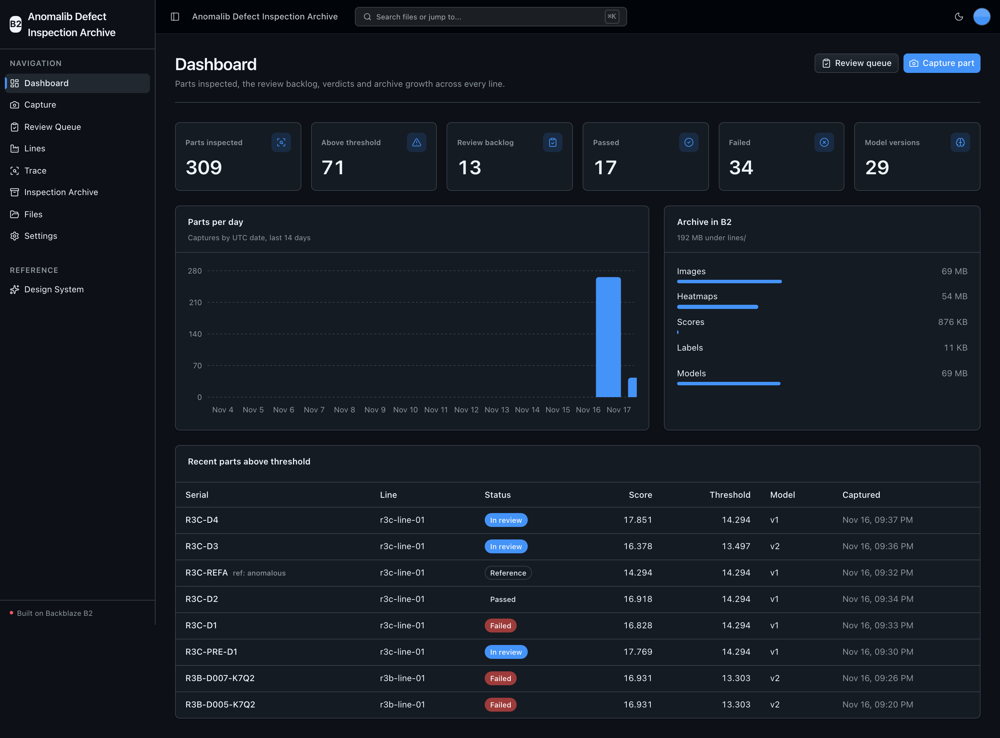
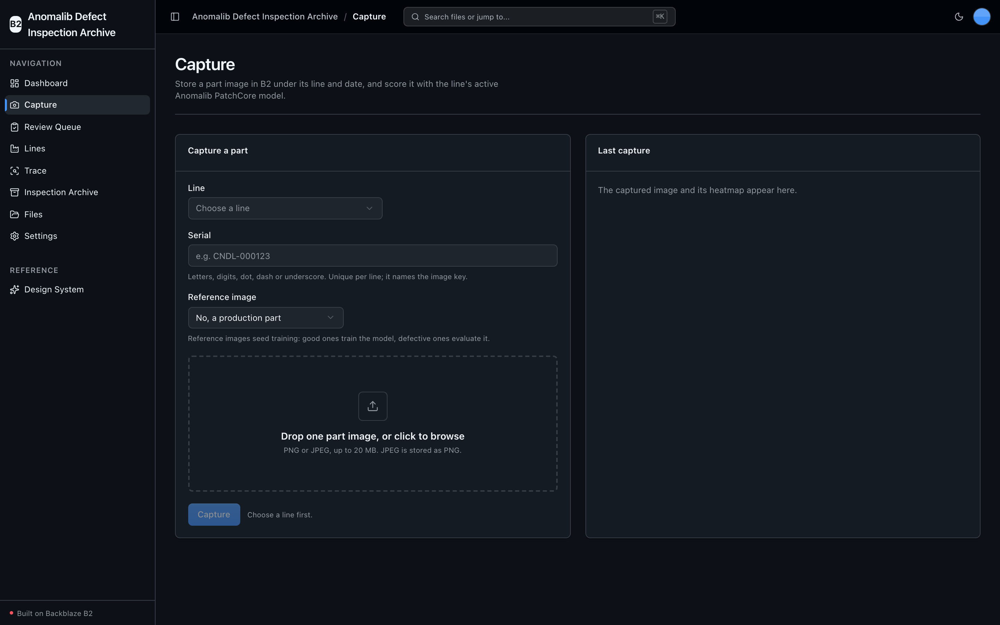
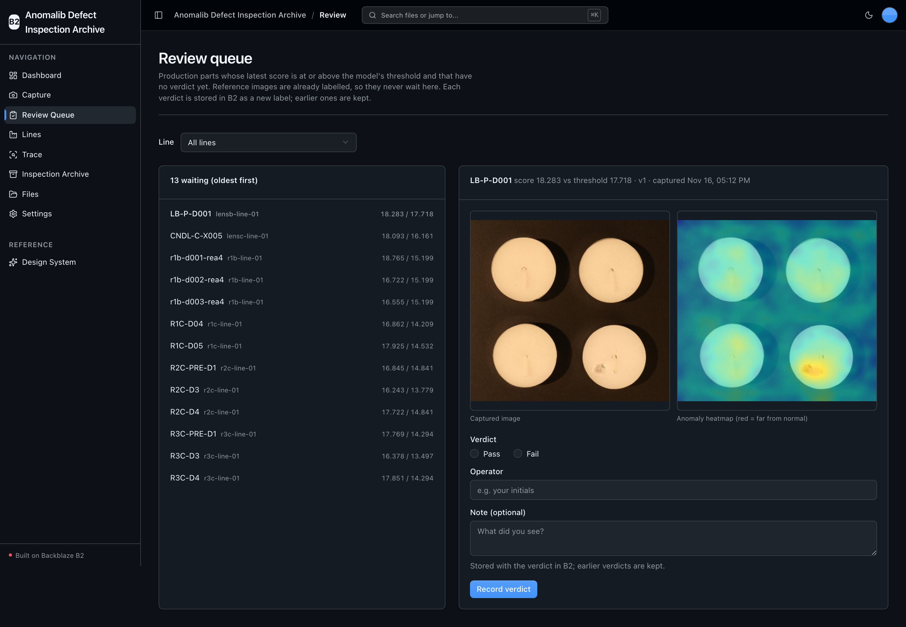
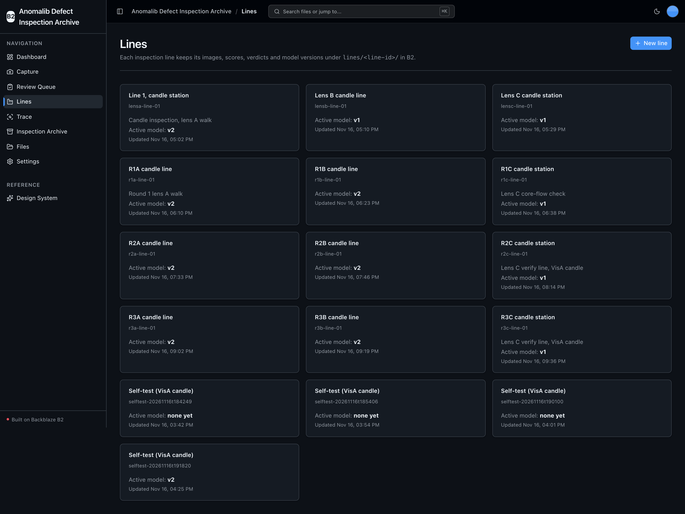
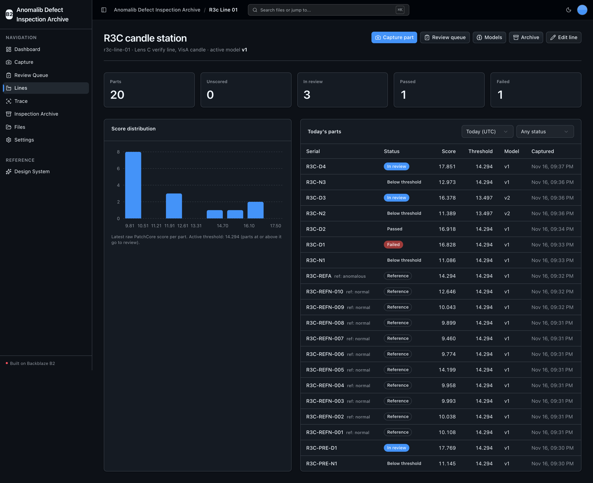
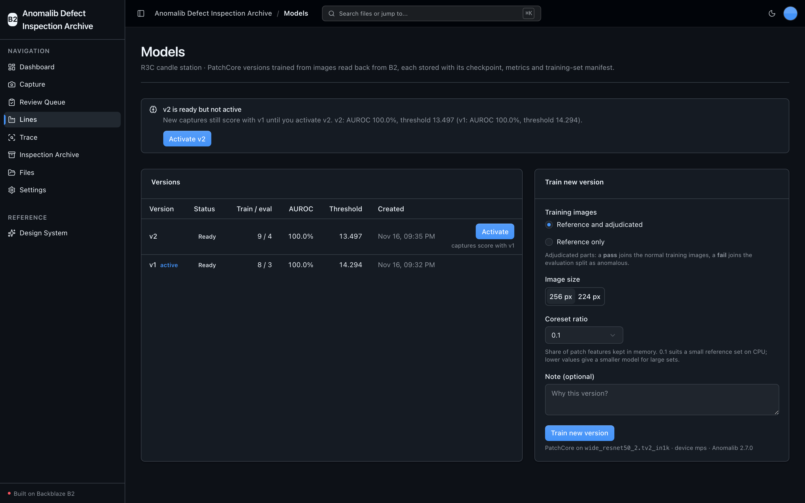
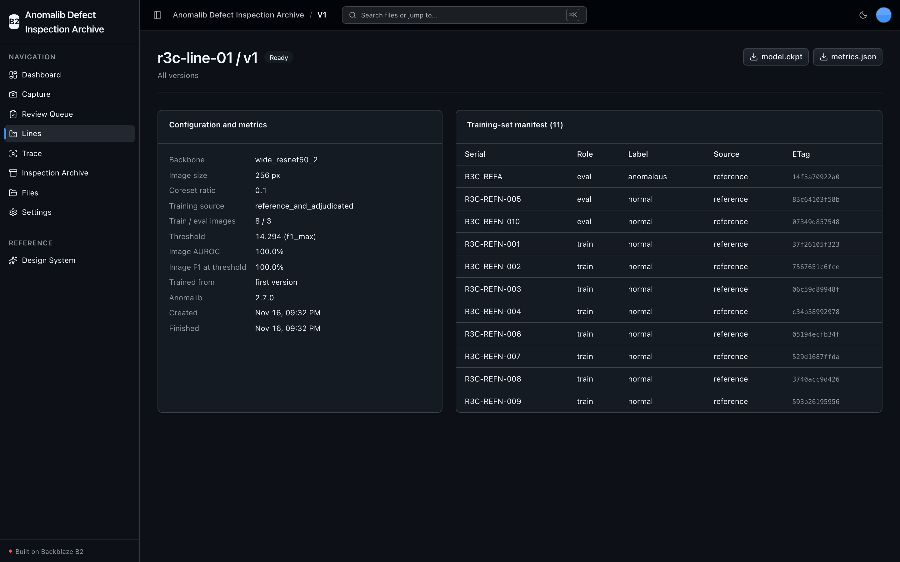
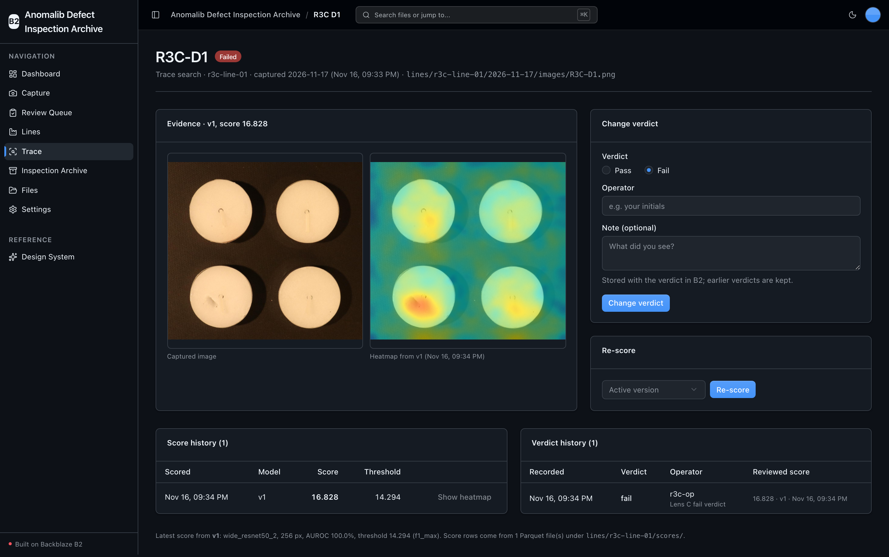
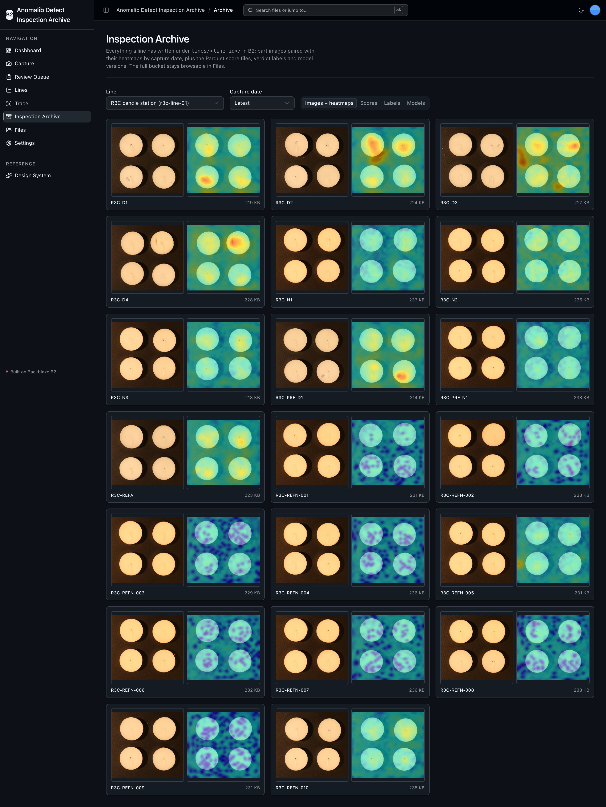

<!-- last_verified: 2026-11-16 -->
<!-- gen:begin readme-header -->
# Anomalib Defect Inspection Archive

Keep every inspected image, heatmap and model version in Backblaze B2, and trace any part back to the evidence. An inspection-line archive that stores every part image in Backblaze B2, scores it with Anomalib PatchCore, keeps the heatmap and score with the model version behind it, routes high scores to operator review, and retrains new model versions from adjudicated images read back from B2.

Built for developers and AI coding agents: the scaffolding, the storage
wiring and the agent-facing docs are already done, so you start on your
app's own features instead of rebuilding the same shell. Storage is
**[Backblaze B2](https://www.backblaze.com/sign-up/ai-cloud-storage?utm_source=github&utm_medium=referral&utm_campaign=ai_artifacts&utm_content=b2ai-anomalib-inspection-archive)**, integrated through the S3-compatible API.

**What you get out of the box:**
- Full-stack dashboard UI (Next.js 16, React 19, Tailwind v4, shadcn/ui, TanStack Query, Recharts)
- Capture and Scoring — store each part image in B2 and score it with Anomalib PatchCore
- Review Queue — operators record pass or fail on parts above the threshold
- Retraining and Model Versions — train a new model version from adjudicated images read from B2, stored with its metrics
- Trace — a part serial returns its image, heatmap, score, verdict and model version
- Inspection Archive — browse images, heatmaps, scores, labels and models by line and date
- Lines — create inspection lines and choose the active model version
- Dashboard — parts inspected, review backlog, verdicts and archive growth
- Bucket Explorer — browse, preview and download any object in the bucket
- Settings — theme plus labelled demo preference fields
- Backend with a strict layered architecture and structural tests (FastAPI, Python 3.12+, boto3, Pydantic v2, pyarrow, Pillow, Anomalib PatchCore (PyTorch, optional ML extra))
- Agent-optimized docs — your AI coding agent can read the repo and start contributing immediately
<!-- gen:end readme-header -->

<!-- gen:begin readme-screenshots -->
## What it looks like

**Dashboard** — Parts inspected, parts above threshold, review backlog, verdicts and model versions, a parts-per-day chart, archive bytes in B2 by kind, and the latest parts above threshold.



**Capture** — Pick a line, enter a part serial and drop an image; it is stored in B2 under the line and date and scored by the line's active PatchCore model.



**Review Queue** — Parts scoring at or above threshold wait here, oldest first, with the captured image beside its anomaly heatmap and a pass or fail verdict form.



**Lines** — Every inspection line with its description, active model version and last update.



**Line detail** — Per-line counts, the PatchCore score distribution, and the day's parts with status, score, threshold and model version.



**Models** — PatchCore versions trained from images read back from B2, with AUROC and threshold, an activate control, and the form to train a new version.



**Model version detail** — One version's configuration, metrics and the training-set manifest of B2 images with their ETags.



**Trace** — A part serial opened to its image, heatmap, score history and verdict history, with controls to change the verdict or re-score.



**Inspection Archive** — Every image and heatmap a line has written to B2, paired by capture date, with tabs for scores, labels and models.


<!-- gen:end readme-screenshots -->

## How it works

```
camera / operator ──► Capture (/upload) ──presigned PUT──► B2  lines/<line>/<date>/images/<serial>.png
                                │
                                ▼
                 API: local cache (filled from B2) ──► Anomalib PatchCore (CPU, or CUDA / Apple MPS)
                                │
            heatmap PNG + one new Parquet score file ──► B2  lines/<line>/<date>/heatmaps/, scores/
                                │
                 score ≥ threshold ──► Review Queue ──► verdict label ──► B2  lines/<line>/labels/
                                │
     adjudicated + reference images read back from B2 ──► train v<N+1> ──► B2  lines/<line>/models/v<N+1>/
```

1. **Capture** a part image under a line and serial. The browser uploads it straight
   to B2; the API scores it with the line's active PatchCore model.
2. **Score**: the image score, threshold, model version and Anomalib version go into a
   new Parquet part file; the anomaly heatmap is stored next to the image.
3. **Review**: parts at or above the threshold wait for an operator's pass or fail.
4. **Retrain**: `pass` parts join the normal training images and `fail` parts the
   evaluation split. The new version is trained from images **read back from B2** and
   stored with its checkpoint, metrics and a manifest of every image key and ETag.
5. **Trace**: any serial returns its image, every heatmap and score with the model
   behind it, and the verdict history.

**Why B2 here.** An inspection archive only grows: every part image, every heatmap,
every model version is kept so a result can be explained later. B2 holds all of it
behind the S3-compatible API, with no database next to it: Parquet score files,
JSON labels and model records sit beside the images they describe. Training reads
its data back from the same bucket, so the archive *is* the training set.

**No second API key.** Anomaly detection runs locally with open source software
(Anomalib, Apache-2.0). Cost of a demo run is B2 storage and transactions only.

## Quick Start

You need: Node.js >= 20, pnpm >= 10, Python >= 3.12, and a free **[Backblaze B2 account](https://www.backblaze.com/sign-up/ai-cloud-storage?utm_source=github&utm_medium=referral&utm_campaign=ai_artifacts&utm_content=b2ai-anomalib-inspection-archive)**. A GPU is optional.

```bash
git clone https://github.com/backblaze-b2-samples/anomalib-defect-inspection-archive.git
cd anomalib-defect-inspection-archive
pnpm run setup        # .env from .env.example, workspace deps, API venv from requirements.lock
pnpm setup:ml         # optional ML extra: Anomalib, PyTorch (CPU wheels on macOS), Lightning, timm
```

> Use the `pnpm run` form for `setup` (and `doctor`): both are built-in pnpm
> commands before pnpm 11, so bare `pnpm setup` runs pnpm's own command.

Without `pnpm setup:ml` the app still runs: captures are stored as `Unscored`, and
scoring and training answer with the install command.

**Add your B2 credentials.** Open `.env` and head to the [Backblaze B2 dashboard](https://secure.backblaze.com/b2_buckets.htm?utm_source=github&utm_medium=referral&utm_campaign=ai_artifacts&utm_content=b2ai-anomalib-inspection-archive):

<!-- gen:begin readme-credentials -->
1. **Create a bucket** and an **application key** with `Read and Write`
   permission, then paste each value into `.env`:
   - `B2_APPLICATION_KEY_ID` — B2 application key ID (**keyID** in the B2 console)
   - `B2_APPLICATION_KEY` — B2 application key (**applicationKey**), shown once at creation
   - `B2_BUCKET_NAME` — bucket unique name (**Bucket Unique Name** in the B2 console)
   - `B2_REGION` — the region inside the bucket's **Endpoint** (`s3.<region>.backblazeb2.com`); the S3 endpoint is derived from it

   B2 shows an application key once, at creation. The optional variables are
   documented in `.env.example` and in the delivery runbooks.
<!-- gen:end readme-credentials -->

> Walkthroughs: [creating a bucket](https://www.backblaze.com/docs/cloud-storage-create-and-manage-buckets) and [creating app keys](https://www.backblaze.com/docs/cloud-storage-create-and-manage-app-keys).

Two optional inspection settings: `INSPECTION_DEVICE` (`auto` by default: CUDA, then
Apple MPS, then CPU; or `cpu`, `cuda`, `mps`) and `INSPECTION_CACHE_DIR` (the local
cache Anomalib reads from, filled from B2; default `services/api/.cache/inspection`,
safe to delete).

**Run it.**

```bash
pnpm dev              # web on localhost:3000, API on localhost:8000 (/docs for Swagger)
```

`pnpm dev` runs the `pnpm run doctor` preflight first (Node/Python versions, venv,
placeholder `.env`, busy ports). Local scripts run on macOS, Linux and WSL2; see
[docs/verification.md](docs/verification.md#local-environments) for sandbox and port details.

### First run in the UI

1. **Lines** → "New line", e.g. `line-01`, "Line 1, candle station".
2. **Capture** a handful of known-good parts as *reference: known-good*, and one or
   two known-defective ones as *reference: known-defective*.
3. **Models** → "Train new version" (defaults are fine). The first ready version
   becomes active.
4. **Capture** production parts: each is scored on arrival; flagged ones appear in
   the **Review Queue**. Record verdicts, train `v2`, activate it, and **Trace** any
   serial.

### Self-test and demo with real data

```bash
make test             # real B2 test bucket + real PatchCore on CPU, end to end
make demo             # same flow against the running `pnpm dev`, then opens /review
```

`make test` downloads a small VisA subset, creates a run-unique `selftest-<utc-ts>`
line, trains `v1` from reference images read back from B2, captures and scores new
parts, records verdicts, trains `v2` from the adjudicated set and traces a part. It
never deletes what it wrote (inspection records are never deleted), so **point it at
a test bucket**. Expect it to take minutes on a laptop CPU.

## Model, weights and data

| | |
| --- | --- |
| Anomaly library | [Anomalib](https://github.com/open-edge-platform/anomalib) `2.7.0` (Apache-2.0), model **PatchCore**, pinned in `services/api/requirements-ml.txt` and verified with a real CPU fit and score on Python 3.12, macOS arm64 |
| Backbone | `wide_resnet50_2`, layers `layer2` + `layer3` |
| Weights | [`timm/wide_resnet50_2.tv2_in1k`](https://huggingface.co/timm/wide_resnet50_2.tv2_in1k), license **BSD-3-Clause** per the model card. The engine passes this exact tag, so different weights cannot be picked silently. Downloaded anonymously from the public Hugging Face Hub on first use (no token) |
| Threshold | F1-maximising cut-off on the held-out split read from B2 (normal references plus anomalous references or `fail` verdicts); the 99th percentile of held-out normal scores when there are no anomalies. Scores and thresholds are raw PatchCore units |
| Device | CUDA, then Apple MPS (with `PYTORCH_ENABLE_MPS_FALLBACK=1`, falling back to CPU on an unsupported op), then CPU. `make test` forces CPU. No speed claims: CPU time depends on the machine and image count |

**Demo data: VisA.** The self-test and demo use the *Visual Anomaly* (VisA) dataset by
Amazon Science, released under [CC BY 4.0](https://creativecommons.org/licenses/by/4.0/).
`scripts/visa_subset.py` streams the official archive
(`https://amazon-visual-anomaly.s3.us-west-2.amazonaws.com/VisA_20220922.tar`, linked
from [amazon-science/spot-diff](https://github.com/amazon-science/spot-diff)), extracts
only the selected images of the chosen category (default `candle`) using the official
split CSV, downscales them to at most 512 px and caches them locally. No dataset image
is committed to this repository. Citation: Zou, Y., Jeong, J., Pemula, L., Zhang, D.,
Dabeer, O. *SPot-the-Difference Self-Supervised Pre-training for Anomaly Detection and
Segmentation*, ECCV 2022 ([arXiv:2207.14315](https://arxiv.org/abs/2207.14315)).

## When to use

Use this sample when you want a working, traceable visual-inspection pipeline to
study or adapt: part images and every derived artifact on object storage, an
open source anomaly model you can retrain from adjudicated data, and an operator
review loop, all runnable on a laptop.

## When not to use

It does not integrate cameras or PLCs, makes no line-rate or throughput claims, and
does not claim compliance with any quality standard. It has no authentication,
user accounts or tenant isolation: anyone who can reach the API can capture, review
and train. Before adapting it for production you own the security, capacity,
validation and support decisions.

## Core Features

<!-- gen:begin readme-core-features -->
- [Capture and Scoring](docs/features/capture-and-scoring.md) — store each part image in B2 and score it with Anomalib PatchCore
- [Review Queue](docs/features/review-queue.md) — operators record pass or fail on parts above the threshold
- [Retraining and Model Versions](docs/features/retraining.md) — train a new model version from adjudicated images read from B2, stored with its metrics
- [Trace](docs/features/trace.md) — a part serial returns its image, heatmap, score, verdict and model version
- [Inspection Archive](docs/features/inspection-archive.md) — browse images, heatmaps, scores, labels and models by line and date
- [Lines](docs/features/lines.md) — create inspection lines and choose the active model version
- [Dashboard](docs/features/dashboard.md) — parts inspected, review backlog, verdicts and archive growth
- [Bucket Explorer](docs/features/file-browser.md) — browse, preview and download any object in the bucket
- [Settings](docs/features/settings.md) — theme plus labelled demo preference fields
<!-- gen:end readme-core-features -->

## Commands

<!-- gen:begin readme-commands -->
| Command | What it does |
| --- | --- |
| `pnpm run setup` | One-time cold start: copy `.env.example` → `.env` (only if missing), install workspace deps, create the backend venv, install locked API deps |
| `pnpm dev` | Start frontend + backend (runs the `pnpm run doctor` preflight first) |
| `pnpm wait-ready` | Block until the running web + API answer, print one line, exit 0/1 — use instead of sleeping before driving the app |
| `pnpm contract:export` | Export the FastAPI OpenAPI contract into `docs/api/openapi.json` |
| `pnpm contract:check` | Verify the exported contract and the generated client routes agree, both ways |
| `pnpm gen:api` | Regenerate the shared types, the client route registry and the query-key factory from the exported contract |
| `pnpm gen:docs` | Regenerate the marker-delimited doc regions from `docs/exec-plans/sample.json` |
| `pnpm gen:check` | Fail if any generated file or doc region is stale (first step of `pnpm verify:web`) |
| `pnpm verify` | Credential-free pre-PR suite — runs `check:agent-docs`, `verify:api`, then `verify:web` |
| `pnpm verify:full` | `pnpm verify` plus Playwright E2E; needs a live local stack, real `.env`, a free web port, and Chromium |
| `pnpm test:verify` | Run throwaway verification specs from `apps/web/e2e/verify/` against the app, with the shared browser fixtures |
<!-- gen:end readme-commands -->

Inspection-specific: `pnpm setup:ml` (install the ML extra), `make test` (live
self-test), `make demo` (demo against `pnpm dev`). `pnpm verify` is the gate to run
before a PR; it needs `services/api/.venv` from `pnpm run setup` but no B2
credentials, no browser and no ML extra. It breaks down into `pnpm check:agent-docs`,
`pnpm verify:api` (backend lint, tests, structure) and `pnpm verify:web` (generator
drift, frontend lint, unit tests, typecheck + build). Full reference:
[docs/dev-workflows.md](docs/dev-workflows.md#commands) and
[docs/verification.md](docs/verification.md).

## Deploying

Local use is the primary path. A Railway deployment (two services, web and API) is
documented in the [Railway delivery contract](infra/railway/README.md); the default
API build installs only the core requirements, so scoring and training return 503
there until the ML extra is added to that build. There is no Vercel target: PyTorch
training and a model checkpoint do not fit a serverless function. Deploying is
always a human-approved action.

<!-- gen:begin readme-deploy-button -->
_This app does not ship a one-click deploy button._
<!-- gen:end readme-deploy-button -->

## Documentation Map

<!-- gen:begin readme-doc-map -->
| Doc | Purpose |
| --- | --- |
| [AGENTS.md](AGENTS.md) | Agent table of contents — start here |
| [ARCHITECTURE.md](ARCHITECTURE.md) | System layout, layering, data flows |
| [docs/features/](docs/features/) | Feature docs (capture and scoring, review queue, retraining and model versions, trace, inspection archive, lines, dashboard, bucket explorer, settings) |
| [docs/design-system.md](docs/design-system.md) | Design tokens, primitives, loader, error/empty states |
| [docs/app-workflows.md](docs/app-workflows.md) | User journeys |
| [docs/dev-workflows.md](docs/dev-workflows.md) | Engineering workflows, command index, releases |
| [docs/verification.md](docs/verification.md) | What each gate checks, and failure recovery |
| [docs/frontend-conventions.md](docs/frontend-conventions.md) | Frontend conventions, screens, data fetching |
| [docs/SECURITY.md](docs/SECURITY.md) | Security principles |
| [docs/RELIABILITY.md](docs/RELIABILITY.md) | Reliability expectations |
| [docs/api/openapi.json](docs/api/openapi.json) | The checked-in API contract the client seam is generated from |
| [infra/railway/README.md](infra/railway/README.md) | Railway delivery contract |
| [docs/exec-plans/](docs/exec-plans/) | Execution plans, tech debt, and the sample manifest |
<!-- gen:end readme-doc-map -->

## Agent-first repository

[AGENTS.md](AGENTS.md) is the single source of truth for coding agents; CLAUDE.md,
GEMINI.md and the Copilot instructions point to it. Layering
(`types -> config -> repo -> service -> runtime`), SDK containment (boto3, pyarrow
and the ML stack each confined to `repo/`), the 300-line limit and the generated API
seam are enforced by tests and `pnpm verify`, not by convention.

## Maintenance and support

Backblaze maintains this open-source sample to help developers get started with B2.
Report repository defects and feature requests through
[GitHub Issues](https://github.com/backblaze-b2-samples/anomalib-defect-inspection-archive/issues);
for B2 account, billing, service, or API help, use
[Backblaze Support](https://www.backblaze.com/help). This sample is not covered by the
Backblaze service level agreement, and no SLA is provided for the repository
software.

## License

MIT License, see [LICENSE](LICENSE). Anomalib is Apache-2.0; the backbone weights are
BSD-3-Clause; the VisA dataset is CC BY 4.0 and is downloaded, not redistributed.
